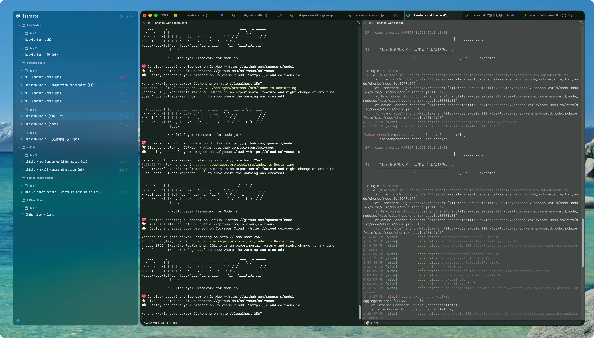

<div align="center">

# iTermate

**专用于 iTerm2 Session 的原生 macOS 伴随面板。**

Keep windows, tabs, projects, shell commands, and coding-agent activity visible at a glance—without leaving your terminal.

[English](README.md) · [简体中文](README.zh-CN.md)

</div>

<p align="center">
  <a href="https://github.com/SSBun/iTermate/releases/latest"></a>
  
  
  
</p>

<p align="center">
  
</p>

## Overview

iTermate 仅在前台 iTerm2 窗口旁显示轻量、可调整尺寸的面板，呈现 Window → Tab → Session 层级，支持按项目目录分组，并展示命令与受支持 Agent 的活动状态。

随 App 分发的 Python Bridge 通过 iTerm2 官方 API 读取和操作会话；导航与状态更新均在本机完成。

## Highlights

- **紧随当前工作区**：仅跟随前台 iTerm2 窗口，切换到其他应用时隐藏。
- **Flexible organization** — group sessions by Window or Project Path, with collapsible Tab subgroups.
- **Direct session control** — focus or close a session, close an entire group, and resize the panel from either edge.
- **Project customization** — pin, favorite, and color-code project folders.
- **Live activity status** — distinguish shell commands from coding-agent work, including elapsed and completion time.
- **Configurable status visuals** — choose Alien, Robot, or Classic animations and colors for each state.
- **Native macOS features** — launch at login, completion notifications, menu-bar controls, appearance settings, and Sparkle updates.
- **Coding-agent integrations** — optional lifecycle reporting for [Pi](https://github.com/badlogic/pi-mono) and [Codex](https://github.com/openai/codex).
- **No Accessibility permission required** — iTermate follows iTerm2 without controlling the Mac through Accessibility APIs.

## Requirements

- macOS 13 Ventura or later
- Apple Silicon Mac (`arm64`) for the downloadable release
- 已安装 [iTerm2](https://iterm2.com/)。

## Installation

1. Download the latest DMG from [GitHub Releases](https://github.com/SSBun/iTermate/releases/latest).
2. Open the DMG and drag **iTermate** into **Applications**.
3. 先启动 iTerm2，再打开 iTermate。
4. Approve Automation access when macOS asks iTermate to communicate with the terminal.

> [!IMPORTANT]
> Current release builds are ad hoc signed and are **not notarized by Apple**. Verify the published `.sha256` file, then Control-click **iTermate.app** and choose **Open** if macOS blocks the first launch.

When iTerm2 is used, iTermate installs and manages its bundled Bridge in iTerm2's AutoLaunch scripts directory. No separate Python setup is required.

## Usage

### Navigate sessions

- Use the panel menu to switch between **Window** and **Project Path** grouping.
- Click a Session to activate its Tab and pane in iTerm2.
- Hover a Session to reveal its close button.
- Expand or collapse Window, Tab, and Project Path sections.
- Use a Project Path context menu to pin, favorite, or assign a custom color.

### Configure iTermate

Open the gear button in the panel or the iTermate menu-bar item to configure:

- 是否在 iTerm2 中显示面板；
- preferred left or right docking side;
- system, light, or dark panel appearance with blur or opaque backgrounds;
- accent color, font, and font size;
- Tab headers, project-title style, session times, and time format;
- completion notifications and launch at login;
- per-state status animation style and color.

### Enable coding-agent status

Open **Settings → Agents** to configure the integration you use:

- **Pi:** enable Pi, then run `/reload` in existing Pi sessions.
- **Codex:** run the original `codex` command normally. iTermate monitors its TTY process and native session lifecycle, then uses the selected local model to create a short Session title after the first completed task; no hooks or wrapper are required.

目前支持 Pi 与 Codex。普通命令状态由 iTerm2 Bridge 和 iTerm2 Shell Integration 观察，不再提供独立的命令上报 hook。

## Troubleshooting

- **“Waiting for iTerm2 Bridge”** — make sure iTerm2 is running, allow iTermate under **System Settings → Privacy & Security → Automation**, then restart iTerm2 if needed.
- **Stale activity state** — use the refresh button in the panel header; it restarts only the Bridge and does not restart iTerm2 or its sessions.
- **Missing agent state** — for Pi, confirm the integration is enabled and reload it. For Codex, confirm the process is running in the foreground process tree of a visible terminal session.

## Build from source

The Xcode project is checked in and resolves [Sparkle 2](https://github.com/sparkle-project/Sparkle) with Swift Package Manager.

```bash
git clone https://github.com/SSBun/iTermate.git
cd iTermate
open iTermate.xcodeproj
```

Select the **iTermate** scheme in Xcode and run it, or build from the command line:

```bash
xcodebuild -project iTermate.xcodeproj \
  -scheme iTermate \
  -configuration Debug \
  build
```

[`project.yml`](project.yml) is the source of truth for project settings. After changing it, regenerate the Xcode project with [XcodeGen](https://github.com/yonaskolb/XcodeGen):

```bash
xcodegen generate
```

## Project structure

| Path | Responsibility |
| --- | --- |
| [`iTermate/`](iTermate/) | Native SwiftUI/AppKit app, floating panel, settings, notifications, and Bridge client |
| [`iTermateBridge/`](iTermateBridge/) | Bundled Python helper that reads and controls iTerm2 through its official API |
| [`integrations/`](integrations/) | Optional Pi and Codex lifecycle adapters |
| [`iTermateTests/`](iTermateTests/) | Tests for grouping, Bridge messages, integrations, layout, and notifications |
| [`docs/appcast.xml`](docs/appcast.xml) | Sparkle update feed |
| [`project.yml`](project.yml) | Canonical XcodeGen project configuration |

## Updates and releases

iTermate checks for updates with Sparkle. You can also choose **Settings → About → Check for Updates…** or visit [GitHub Releases](https://github.com/SSBun/iTermate/releases).

See [`CHANGELOG.md`](CHANGELOG.md) for release notes.
